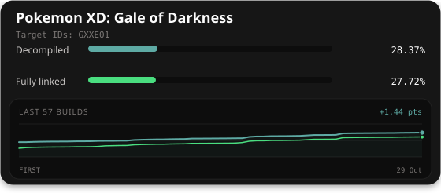

# GXXE01

A work-in-progress decompilation of GXXE01 (Game ID `GXXE01`).

This project uses [decomp-toolkit](https://github.com/encounter/decomp-toolkit).

## Project status

Game ID: `GXXE01`

Documentation
-------------

- [Dependencies](docs/dependencies.md)
- [Getting Started](docs/getting_started.md)
- [`symbols.txt`](docs/symbols.md)
- [`splits.txt`](docs/splits.md)
- [GitHub Actions](docs/github_actions.md)

General:

- [Common BSS](docs/common_bss.md)
- [`.comment` section](docs/comment_section.md)

References
--------

- [Discord: GC/Wii Decompilation](https://discord.gg/hKx3FJJgrV) (Come to `#dtk` for help!)
- [objdiff](https://github.com/encounter/objdiff) (Local diffing tool)
- [decomp.me](https://decomp.me) (Collaborate on matches)
- [decomp.dev](https://decomp.dev) (Decompilation progress hub and API)
- [wibo](https://github.com/decompals/wibo) (Minimal Win32 wrapper for Linux)
- [sjiswrap](https://github.com/encounter/sjiswrap) (UTF-8 to Shift JIS wrapper)

Nearly all active GC/Wii decompilation projects use this structure, and will be useful
for reference. A list of active GC/Wii projects can be found on [decomp.dev](https://decomp.dev).

Features
--------

- Few external dependencies: Just `python` for the generator and `ninja` for the build system. See [Dependencies](docs/dependencies.md).
- Simple configuration: Everything lives in `config.yml`, `symbols.txt`, and `splits.txt`.
- Multi-version support: Separate configurations for each game version, and a `configure.py --version` flag to switch between them.
- Feature-rich analyzer: Many time-consuming tasks are automated, allowing you to focus on the decompilation itself. See [Analyzer features](https://github.com/encounter/decomp-toolkit#analyzer-features).
- REL support: RELs each have their own `symbols.txt` and `splits.txt`, and will automatically be built and linked against the main binary.
- No manual assembly: decomp-toolkit handles splitting the DOL into relocatable objects based on the configuration. No game assets are committed to the repository.
- Progress calculation and integration with [decomp.dev](https://decomp.dev).
- Integration with [objdiff](https://github.com/encounter/objdiff) for a diffing workflow.
- CI workflow template for GitHub Actions.

Project structure
-----------------

- `configure.py` - Project configuration generator (reads from TOML config files).
- `config/` - TOML configuration files.
- `config/GXXE01` - Version-specific configuration files (libs.toml, flags.toml).
- `config/GXXE01/build.sha1` - SHA-1 hashes for each built artifact, for final verification.
- `build/` - Build artifacts generated by the the build process. Ignored by `.gitignore`.
- `orig/GXXE01` - Original game files, extracted from the disc. Ignored by `.gitignore`.
- `orig/GXXE01/.gitkeep` - Empty checked-in file to ensure the directory is created on clone.
- `src/` - C/C++ source files.
- `include/` - C/C++ header files.
- `tools/` - Scripts shared between projects.
